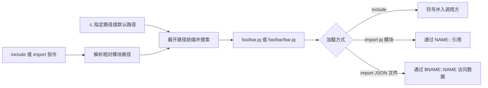

# jq 模块与库搜索

> 本文区分手册提取、本机 `jq-1.8.2` 的有限运行观察和独立重建状态。上游参考二进制的构建来源未核实；固定源码见 [SOURCES.md](SOURCES.md)。

## 模块文件与搜索路径

jq 模块是以 `.jq` 结尾的文件。`-L directory` 指定模块搜索目录；使用该选项时不采用内置默认搜索路径。未使用 `-L` 时，手册给出的默认路径是 `~/.jq`、`$ORIGIN/../lib/jq`、`$ORIGIN/../lib`。

路径前缀的含义：

- `~/` 展开为用户主目录。
- `$ORIGIN/` 展开为 jq 可执行文件所在目录。
- `./` 或 `.` 相对于包含该路径的文件；命令行直接给出的顶层程序以当前目录为基准。
- 搜索路径中的空字符串或 `null` 会终止后续搜索路径处理。

导入相对路径 `foo/bar` 时，搜索项中会尝试 `foo/bar.jq` 和 `foo/bar/bar.jq`。连续重复的目录名（例如 `foo/foo`）不允许。若用户主目录中存在名为 `.jq` 的普通文件，它会自动作为主程序的一部分加载。

## 加载指令与元数据

- `include "path";` 将找到的 jq 模块按文本包含的方式加载，模块定义进入调用方命名空间。
- `import "path" as NAME;` 加载 jq 模块，模块符号以 `NAME::` 前缀访问。
- `import "path" as $NAME;` 加载 JSON 文件，文件数据可通过 `$NAME::NAME` 访问；此形式会补 `.json` 后缀。
- jq 模块可以用 `module <constant-expression>;` 声明可选元数据。导入指令也可带常量元数据；其中 `search` 字段接受字符串或字符串数组，并作为前置路径加入顶层搜索路径。
- `modulemeta` 返回模块元数据，并将导入项列在 `deps`、定义列在 `defs` 中。

jq 的模块导入是被重建软件自身的运行时能力，不等于 Recipkg 配方依赖。不要据此把 jq 模块源码放进配方归档，也不要把普通 jq 模块仓库声明成 Recipkg 配方。

## 本机运行观察

2026-10-29，本机 `/usr/bin/jq --version` 报告 `jq-1.8.2`。尚未证明该二进制由配方中固定的源码提交构建。以下结果来自临时目录中的独立命令行样本：

- `-L A -L B` 对相同模块名先选 `A`；交换参数顺序后先选 `B`。
- 对 `include "foo/bar";`，同时存在 `foo/bar.jq` 和 `foo/bar/bar.jq` 时选前者；只存在后者时也能加载。
- 模块中的普通 `include "leaf";` 可通过同一 `-L` 搜索目录递归加载。
- 命令行程序中的 `include "./local";` 按当前工作目录查找。嵌套模块内 `include "./leaf";` 的样本也按进程当前目录命中；它没有按模块文件所在目录命中。`-f` 文件路径、其他前缀和更多目录组合仍需单独核实。
- 缺失模块返回退出码 3，stderr 含 `module not found` 和 `1 compile error`。完整诊断格式与平台差异尚未固定。

这些参考样本现用于 `ACCEPTANCE.md` 和黑盒样本仓库的 jq 模块测试。独立重建通过了 9 项有限模块样本，其中 6 项与本机 jq 1.8.2 对照；循环 include 只验证了候选保护逻辑，模块系统整体仍不完整。具体范围见 [`COVERAGE.md`](COVERAGE.md)。

## 尚未验证

手册描述的默认路径、`$ORIGIN` 与 `~/` 展开、完整相对路径规则、`import` 命名空间、JSON 数据导入、模块元数据、`modulemeta` 尚未在重建中实现或验证。循环 include、模块缓存、路径规范化、符号链接、命名冲突、语法错误诊断和跨平台差异也未知。模块系统整体仍不可标为完成或兼容。
