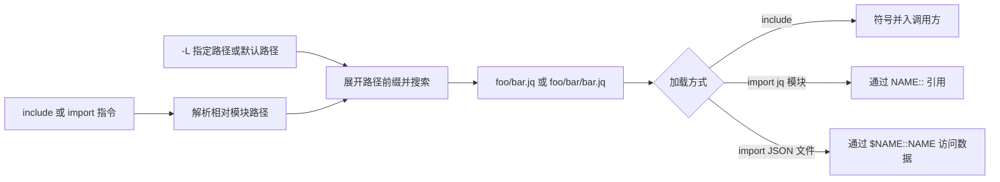

# jq 模块与库搜索

> 本文记录上游 jq 1.8 手册中的模块约定，不代表已在固定上游二进制或独立重建中运行验证。固定源码见 [SOURCES.md](SOURCES.md)。

## 模块文件与搜索路径

jq 模块是以 `.jq` 结尾的文件。`-L directory` 指定模块搜索目录；使用该选项时不采用内置默认搜索路径。未使用 `-L` 时，手册给出的默认路径是 `~/.jq`、`$ORIGIN/../lib/jq`、`$ORIGIN/../lib`。

路径前缀的含义：

- `~/` 展开为用户主目录。
- `$ORIGIN/` 展开为 jq 可执行文件所在目录。
- `./` 或 `.` 相对于包含该路径的文件；命令行直接给出的顶层程序以当前目录为基准。
- 搜索路径中的空字符串或 `null` 会终止后续搜索路径处理。

导入相对路径 `foo/bar` 时，搜索项中会尝试 `foo/bar.jq` 和 `foo/bar/bar.jq`。连续重复的目录名（例如 `foo/foo`）不允许。若用户主目录中存在名为 `.jq` 的普通文件，它会自动作为主程序的一部分加载。

## 加载指令与元数据

- `include "path";` 将找到的 jq 模块按文本包含的方式加载，模块定义进入调用方命名空间。
- `import "path" as NAME;` 加载 jq 模块，模块符号以 `NAME::` 前缀访问。
- `import "path" as $NAME;` 加载 JSON 文件，文件数据可通过 `$NAME::NAME` 访问；此形式会补 `.json` 后缀。
- jq 模块可以用 `module <constant-expression>;` 声明可选元数据。导入指令也可带常量元数据；其中 `search` 字段接受字符串或字符串数组，并作为前置路径加入顶层搜索路径。
- `modulemeta` 返回模块元数据，并将导入项列在 `deps`、定义列在 `defs` 中。

jq 的模块导入是被重建软件自身的运行时能力，不等于 Recipkg 配方依赖。不要据此把 jq 模块源码放进配方归档，也不要把普通 jq 模块仓库声明成 Recipkg 配方。

## 尚未验证

以上内容仅来自固定版本的手册。固定上游二进制与 `jq-source` 均未按这些条件做运行对照。重复 `-L` 的组合顺序、重复候选的优先级、缺失模块与语法错误的诊断和退出码、路径规范化与符号链接、循环导入、模块缓存、命名冲突及各平台路径差异仍未知。模块系统不可标为已实现或兼容。
